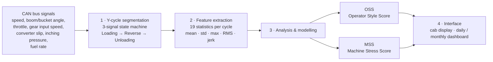

# From Driving Style to Machine Abuse
### An AI pipeline for wheel loader operation

**Author:** Simone De Giorgi
**Context:** Thesis project, *Corso di perfezionamento in Tecnologie Digitali per Ambienti e Sistemi Intelligenti*

---

## 1. Project overview

How aggressively a wheel loader is driven has a direct cost: safety risk, higher fuel consumption and faster wear of engine, transmission and brakes. All three effects leave a signature in the standard CAN signals that the machine already exposes.

The project turns those signals into **two complementary 0–100 indicators, computed cycle by cycle**:

| Indicator | Question it answers | Method |
|---|---|---|
| **OSS: Operator Style Score** | *How is the machine being driven?* | Supervised: cost-sensitive SVM (RBF kernel) + sigmoid calibration |
| **MSS: Machine Stress Score** | *What did this cycle cost the machine?* | Reference-based: deviation from **Normal** operation for fuel, engine, transmission and brakes |

The unit of analysis is the **Y-cycle**: load, reverse, unload. It repeats many times per shift with the same geometry, so two cycles can be compared like two repetitions of the same experiment.

**Key results** (full details in the thesis):

- 1,678 Y-cycles (1,571 Normal, 107 Aggressive, imbalance 14.7 : 1)
- 19 candidate features; 7 selected via mRMR + cross-validation
- The classes separate before any model is trained: PCA, K-means (k = 2), PERMANOVA (F ≈ 1500, p = 0.001, R² = 0.47), Hopkins H = 0.875
- Held-out test set: 100 % Balanced Accuracy (392 Normal / 27 Aggressive, zero errors); 5-fold CV on the full dataset: 1.000 ± 0.000
- OSS and MSS are correlated but not redundant (Spearman ρ = 0.75 on Normal cycles)

---

## 2. System architecture



| # | Stage | Input | Output |
|---|---|---|---|
| 1 | **Y-cycle segmentation**: a state machine on vehicle speed, boom angle and bucket angle detects the three phases and assigns a unique ID to each valid cycle | Continuous CAN trace | Segmented cycles |
| 2 | **Feature extraction**: 19 statistics per cycle covering kinematics, accelerator pedal, braking and inching/clutch | Segmented cycles | One feature vector per cycle |
| 3 | **Analysis & modelling**: separability tests, feature selection, cost-sensitive SVM, OSS, MSS | Feature table + segments | Per-cycle OSS / MSS, trained model, figures |
| 4 | **Interface**: cab display (OSS view / MSS view) and daily/monthly dashboard with per-operator filters | Per-cycle OSS / MSS | Feedback for operators and fleet managers |

Stages 1–2 prepare the per-cycle data. Stage 3 is the core of the project and is released in the **analysis repository**. Stage 4 is presented as a design concept in the thesis, the slides and the **presentation page**.

---

## 3. Component repositories

| Component | Repository |
|---|---|
| Analysis & modelling (OSS / MSS): MATLAB code, thesis, slides | [perfez-2526-DrivingStyleAnalysis-degiorgi](https://github.com/UniSalento-IDALab-corsoPerfez-25-26/perfez-2526-DrivingStyleAnalysis-degiorgi) |
| **Project presentation: web page (GitHub Pages)** | **this repository** ([perfez-2526-presentation-degiorgi](https://github.com/UniSalento-IDALab-corsoPerfez-25-26/perfez-2526-presentation-degiorgi)) |

**Project web page:** https://unisalento-idalab-corsoperfez-25-26.github.io/perfez-2526-presentation-degiorgi/

---

## 4. This repository: project presentation

This repository hosts the **presentation web page** of the project, published with GitHub Pages:

**➜ https://unisalento-idalab-corsoperfez-25-26.github.io/perfez-2526-presentation-degiorgi/**

The page summarises the whole project for a non-specialist reader:
- problem and research question;
- architecture;
- data and features;
- OSS model and MSS method;
- cab interface and dashboards;
- use cases and limits;
- links to every repository.

It is a single static page and needs no build step.

```
.
├── index.html          # the web page (HTML + CSS)
├── .nojekyll           # serve files as they are, without Jekyll processing
├── assets/img/         # figures and screenshots used by the page
└── docs/
    ├── Thesis_DrivingStyle_WheelLoader.pdf
    ├── Slides_DrivingStyle_WheelLoader.pdf
    └── Slides_DrivingStyle_WheelLoader.pptx
```

**Preview locally:** open `index.html` in a browser.
